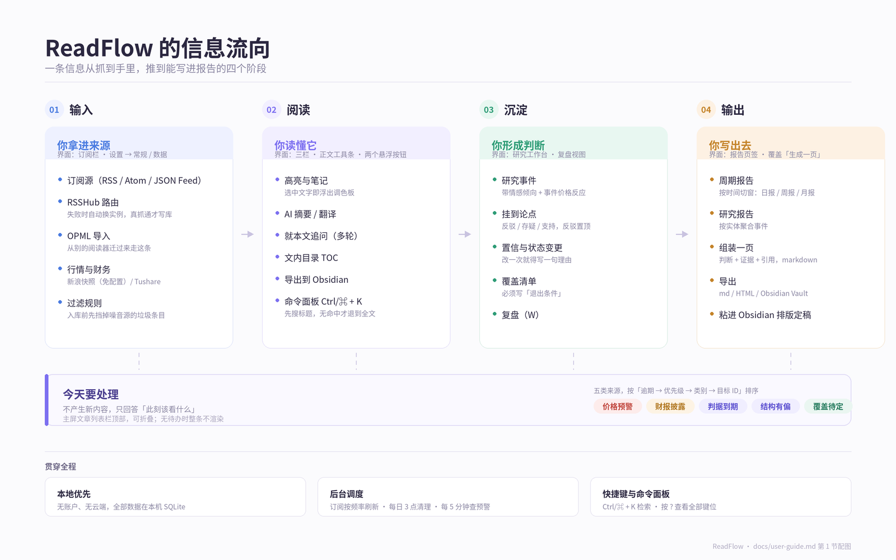
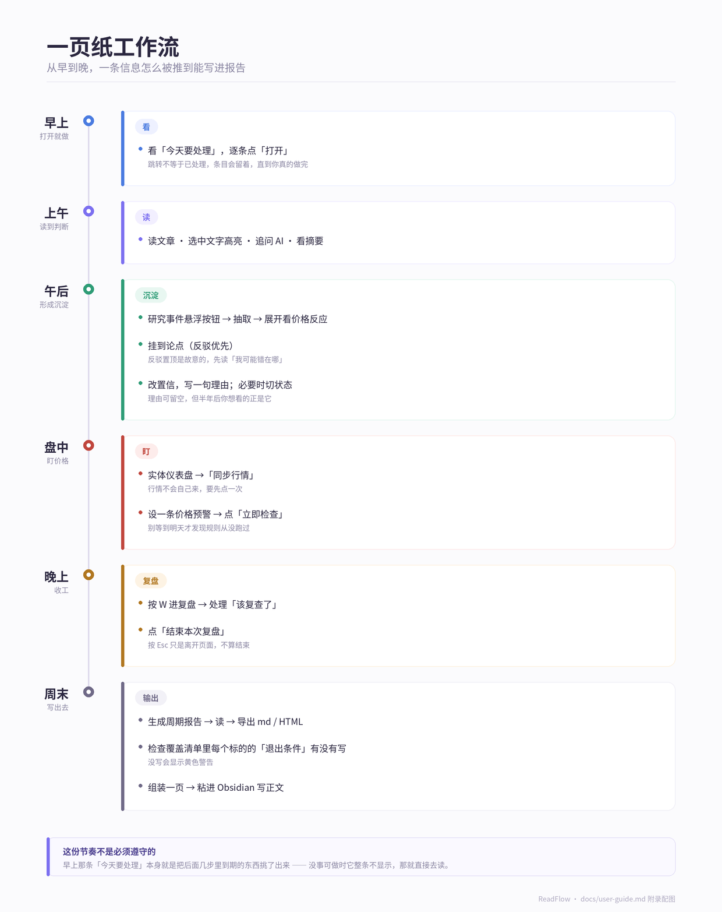

# ReadFlow 操作指南

> 面向使用者的完整操作手册。目标是「照着做，把一条信息从抓到手里，一直推到能写进报告」。
>
> 本文覆盖全部界面，并承接早期「研究工作台使用指南」的设计动机（为什么反驳置顶、为什么证据快照不可回填、
> 为什么没有退出条件的覆盖会退化成名单）。那份指南已删除——它写的四个页签、三类自动化现在都不存在。

## 目录

1. [认识这个应用](#1-认识这个应用)
2. [首次启动](#2-首次启动)
3. [配置](#3-配置)
4. [信息输入：订阅与抓取](#4-信息输入订阅与抓取)
5. [阅读与标注](#5-阅读与标注)
6. [研究事件](#6-研究事件)
7. [行情面板与价格预警](#7-行情面板与价格预警)
8. [实体管理与覆盖清单](#8-实体管理与覆盖清单)
9. [论点台账与复盘](#9-论点台账与复盘)
10. [报告与导出](#10-报告与导出)
11. [今天要处理](#11-今天要处理)
12. [自动化任务](#12-自动化任务)
13. [快捷键总表](#13-快捷键总表)
14. [常见问题排查](#14-常见问题排查)

---

## 1. 认识这个应用

ReadFlow 是一个**本地优先**的投研阅读台：无账户、无云端、所有数据存在本机 SQLite 里。
它的信息流向是固定的四段，界面上所有功能都能对应到这四段中的某一段：

这四段各自包含的内容：

| 段 | 你在这里做什么 | 对应界面 |
|---|---|---|
| **输入** | 订阅源 / OPML 导入、自动抓取、行情与财务数据 | 订阅栏、设置 → 常规/数据 |
| **阅读** | 三栏阅读、高亮、笔记、追问、摘要 | 文章列表栏、正文栏、两个悬浮按钮 |
| **沉淀** | 抽取研究事件，挂到论点，维护覆盖清单，做复盘 | 研究工作台 |
| **输出** | 周期报告、研究报告、组装一页、导出 | 报告页签、覆盖清单、导出菜单 |

把这四段串起来的是**今天要处理**——它不产生新内容，只告诉你此刻该看什么，
免得你每天靠翻页签去自己检查。

### 1.1 主界面结构

顶部是自绘标题栏：左侧 Logo 与名称，中间显示**当前视图名**（选中某个订阅源时显示该源名称，
未选中时显示「全部文章」），右侧三个业务按钮（切换深浅主题 / 刷新全部订阅源 / 打开设置），
最右是窗口的最小化、最大化、关闭。

主体是**三栏并列**，每栏顶部各有独立的操作条：

| 栏位 | 组件 | 职责 |
|---|---|---|
| 左 | 订阅栏 | 「全部文章」入口、订阅源列表、工具栏、`⋯` 更多功能菜单 |
| 中 | 文章列表栏 | 搜索、筛选、排序、文章列表 |
| 右 | 正文栏 | 文章正文、顶部工具条、两个悬浮按钮 |

两条分隔条可以拖拽：订阅栏宽度范围 200–460px，文章列表栏 280–620px。
调整后的宽度会被记住。若你在设置里调过「界面字体大小」，拖拽会自动按缩放比例换算，手感不受影响。

### 1.2 主屏有四种视图（互斥）

正文区的形态由当前视图决定，切换后不是叠加而是替换：

| 视图 | 进入方式 | 说明 |
|---|---|---|
| 文章 | 默认；`G` 键；`Esc` | 三栏阅读，常规形态 |
| 实体关系图 | `⋯` 菜单 → 实体关系图；`D` 键 | **全屏**，订阅栏也会隐藏 |
| 智能推荐 | `⋯` 菜单 → 智能推荐；`T` 键 | 保留订阅栏，右区变成卡片流 |
| 复盘 | `⋯` 菜单 → 复盘；`W` 键 | 保留订阅栏，右区变成整页 |

`Esc` 从这三种视图回到文章视图。**注意：从复盘页按 `Esc` 只是离开页面，不等于「结束本次复盘」**——
复盘是有进行状态的，下次按 `W` 回来仍然接着看原来的内容。

---

## 2. 首次启动

第一次启动（或从没有引导标记的旧版本升级上来）会弹出一个三步向导：

1. **① 添加订阅源** —— 按钮「去添加订阅源」，直接打开添加订阅弹窗
2. **② 添加关注实体** —— 按钮「去添加关注实体」，打开研究工作台
3. **③ 开启自动化** —— 按钮「去设置自动化」，打开设置

每步底部的「下一步 / 上一步」只翻页，不替你执行任何操作；真正跳转的是中间那个实心按钮。
点「跳过」、完成、或按 `Esc`/点遮罩关闭，都视为引导结束，**只弹这一次**。

新手建议的最小可用路径（三步走完就能跑起来）：

1. 加 3–5 个订阅源 → 点「刷新全部订阅源」等文章进来
2. 「设置 → AI 设置」填 API Base URL 与 API Key（不填也能读，但摘要/翻译/抽取都用不了）
3. 「设置 → 自动化」建一个每日的「提取」任务

---

## 3. 配置

设置有两个入口：标题栏齿轮按钮，或快捷键 `,`。左侧五个页签，一次只挂载一个。
底部「取消」「保存」只对**常规 / Obsidian / AI** 三页出现；**自动化 / 数据**两页的操作是即时生效的，
没有「保存」这个概念，改完就落库。

设置与研究工作台都是**长会话面板**（面板四周的遮罩只剩十几像素余量），所以它们**不响应「点遮罩关闭」**——
出口只有 `Esc` 与右上角 `✕`。其余短弹窗（选标签、确认框、导出菜单）仍然可以点外面关掉。

### 3.1 常规

字段按从上到下的顺序：

| 区块 | 内容 |
|---|---|
| 外观 | 主题（浅色/深色/跟随系统）、界面字体大小、界面字体、内容字体、阅读字体大小 |
| RSSHub | 实例地址，占位符 `https://rsshub.app` |
| 网络代理 | 占位符 `http://127.0.0.1:7890 或 socks5://127.0.0.1:1080` |
| 金融数据源 | 新浪（免配置，实时快照默认源）；Tushare Token；东财 API Key |
| 刷新 | 刷新频率（**改后需重启应用生效**）；按来源自动分组开关 + 「立即整理存量订阅源」 |
| 通知 | 系统通知（总开关）、事件预警、价格预警、复盘提醒 |
| 事件类型 | 领域分类 chips + 自定义事件类型 |
| 窗口 | 关闭到托盘 |
| 保留 | 文章保留策略、保留未读文章、「立即清理旧文章」 |

以下是几个**容易踩坑**的点，值得单独说明：

**代理「留空」等于强制直连。** 不是「不干预、交给系统」，而是明确不走任何代理——
既不走系统代理，也不读环境变量里的 `HTTP_PROXY` / `HTTPS_PROXY`。本机地址（loopback）永远不会走代理。
填了地址后会自动补协议前缀（`127.0.0.1:7890` 会变成 `http://127.0.0.1:7890`）。

**RSSHub 实例地址不是死绑。** 填一个地址后，如某个源抓取失败且判定为 RSSHub 路由问题，
应用会自动尝试换到其它公共实例，真抓通了才写库、并把新实例地址回写到这里。
换实例有三道护栏：同一轮最多换 3 次、总预算 10 秒、实例本身不可达时立刻放弃。
**「路由内抛异常」与「实例自身故障」HTTP 状态码相同（都是 503）**，应用靠响应体特征区分；
认不出的情况按「实例故障」处理——宁可让你多试一次，也不误判成路由故障把你拦住。

**事件类型分类决定 AI 能抽出什么。** 如果所有领域都被取消勾选，界面会警告
「当前 AI 抽取将不会识别任何事件」。自定义类型支持 `如：开源发布 / release` 这样的
「中文名 / 英文标识」写法，英文标识会作为 `event_type` 存库、也是事件圆点配色的键。

**保留策略会删掉被挂为证据的文章。** 清理按**发布日期**判断，豁免只有三种：已收藏、
未读（默认开）、没有发布日期。所以带 `published_at` 的旧文章一旦过期就会被删。
**这意味着证据的「谁说的」必须在挂载当下就快照保存，事后无法回填**——这是设计上有意为之，
你在证据详情里看到的是快照文本，不是重新去读一遍原文。

### 3.2 AI 设置

三个字段：

| 字段 | 说明 |
|---|---|
| AI 摘要 / AI 翻译 | 两个独立开关 |
| 默认模型 | 占位符 `例如 agnes-2.5-flash` |
| API Base URL | 占位符 `https://apihub.agnes-ai.com/v1`，**无需**带 `/chat/completions` |
| API Key | 密码框，旁边标「已配置 / 未配置」，提示「已保存（留空则不修改）」 |

关掉这两个开关会直接反映到阅读区：译文按钮变灰、悬停提示「AI 翻译已在设置中关闭」；
摘要悬浮按钮不再出现。API Key 只存在本地 SQLite（明文，因此 `.db` 文件在 git 里是被忽略的）。

### 3.3 Obsidian

两个字段：Vault 路径（`例如 /Users/you/Documents/MyVault`）、导出目录（默认 `ReadFlow`）。
配好之后，文章工具条的导出按钮与 `E` 快捷键才会真正落盘。

### 3.4 数据

上半部五项统计：订阅源数、文章总数、已读、未读、收藏。
中间「数据库备份」：备份 / 恢复。下半部「订阅源备份」：导入 OPML / 导出 OPML。

**导入 OPML 是迁移期最重要的入口**，从别的 RSS 阅读器搬过来基本全靠它。

### 3.5 自动化

见 [第 12 节](#12-自动化任务)。

---

## 4. 信息输入：订阅与抓取

### 4.1 添加订阅源

三种入口：订阅栏工具栏的 `+`、快捷键 `O`、首启向导第二步。

弹窗两个字段：**订阅地址**（占位符 `https://example.com/feed.xml`）、**名称**（留空则自动抓取源标题）。
添加后图标会自动回填（站点 favicon 兜底，只补空值，不会覆盖你手填的）。

支持的类型远不止 RSS：RSSHub 路由、Atom、JSON Feed 都可以贴。

### 4.2 管理单个订阅源

点订阅源右键或在列表项上操作，可打开管理弹窗，字段包括：名称（占位符「订阅源名称」）、URL（带「复制」按钮）、
两处 AI 指令输入（都提示「留空使用全局默认指令」），底部「删除」/「取消」。

### 4.3 删除订阅源：可撤销

点删除**不会立刻落库**：源会先从列表移除，底部弹出提示，有 6 秒的「撤销」窗口。
6 秒后自动提交删除。这段时间里重新加载列表不会让它「复活」，可以放心。

### 4.4 刷新

三个入口，都走同一条链路：

- 标题栏的循环箭头按钮
- 订阅栏 `⋯` 菜单右侧的「刷新全部订阅源」（会显示 `n/m` 进度）
- 快捷键 `R`

单源刷新在文章列表栏的工具栏里，按钮 title 会跟着当前是否选中源而变。

### 4.5 订阅栏 `⋯` 更多功能菜单

从上到下八项：新建文件夹、过滤规则、研究工作台、智能摘要、实体关系图、智能推荐、复盘、阅读洞察。
「实体关系图」「智能推荐」「复盘」三项就是 1.2 节里那三种视图的入口。

### 4.6 过滤规则

「过滤规则」菜单项打开规则管理。用途是**在入库前**按标题/链接等内容特征挡掉噪音源里的垃圾条目，
比事后在列表里筛选更省事——尤其适合那些「每天 200 条但只有 5 条有用」的源。

---

## 5. 阅读与标注

### 5.1 文章列表栏的操作条

从左到右：

| 元素 | 作用 |
|---|---|
| 搜索框 | 标题与正文检索，有内容时右侧出现 `×` 清空 |
| 标签 chip | 进入标签视图 |
| 仅未读 | 筛选，快捷键 `U` |
| 仅书签 | 筛选，快捷键 `B` |
| 仅喜欢 | 筛选 |
| 仅跳过 | 筛选 |
| 刷新 | 刷新当前范围（按钮 title 随之变化） |
| 全部标记已读 | 快捷键 `M` |

四个筛选按钮是**单一选中**关系，不是多选叠加。

排序另有独立的一行（发布时间 / 相关度等）。滚到底部会自动加载更多，
`J` 键也能触发加载更多。

### 5.2 正文工具条的九个动作

| 图标语义 | 动作 | 快捷键 |
|---|---|---|
| 信封 / 对勾 | 切换已读 / 未读 | — |
| 星标 | 收藏 / 取消收藏 | `S` |
| 标签 | 打开标签浮层（显示已挂数量） | — |
| 目录 | 显示文章内 h1–h3 目录 | — |
| 译 | AI 翻译（生成中禁用） | — |
| 方框 | 专注模式 | `F` |
| 导出 | 导出到 Obsidian | `E` |
| `⋯` | 更多菜单 | — |

**目录按钮**只在文章内部有**两个及以上**标题时才出现（约 6% 的文章符合），
只取 h1–h3。没有标题的文章看不到这个按钮，这不是坏了。

`⋯` 更多菜单四项：复制链接、复制标题、打开原文（`V`）、生成摘要 / 重新生成摘要。

**专注模式**会隐藏订阅栏和文章列表栏，只留正文。`Esc` 或再按 `F` 退出。
退出顺序上，`Esc` 先退专注模式，再退非文章视图，最后才交给弹窗自己处理。

### 5.3 文本标注

选中正文文字会浮出高亮面板，选颜色即可标记。高亮会落库并进入检索范围
（命令面板里搜「高亮」类型的结果就是它）。高亮可以后续挂到论点上作为证据。

### 5.4 两个悬浮按钮

选中文章后，正文右下角出现两个按钮（专注模式或网页内嵌视图下不出现）：

**研究事件（ResearchFab）** —— 圆钮带 badge，数字是本文已抽出的事件条数（超过 99 显示 `99+`）。
悬停提示三态：无事件时「从本文提取结构化研究事件」、有事件时「已提取 N 条研究事件」、进行中「正在提取…」。
展开后是一个面板：标题「研究事件」、一个提取按钮（文案随状态变）、事件列表（彩色圆点表示事件类型 + 事实简述）。

注意面板内部有两件独立的事：**「这次点过提取了」** 和 **「真的抽到了事件」**。
抽不到不等于失败，模型可能判断这篇文章没有可结构化的事件。

**文章追问（ArticleChat）** —— 就当前文章向 AI 提问，可多轮。
悬停提示三态：首问「就这篇文章向 AI 提问」、已有对话时「继续追问（已有 N 条对话）」、回答中「正在回答…」。

### 5.5 命令面板

`Ctrl/⌘ + K` 唤起，一个输入框搜两类东西：**文章** 和 **你自己写的东西**（高亮 / 判断 / 证据）。

检索是两段式：**先只搜标题**，标题一条都没有才自动退到全文检索。右上角的小标签会如实显示
当前是「标题」还是「全文」——这样你输入「AI」时就不会被一堆正文里提到 AI 的无关文章淹没。

键盘：`↑` `↓` 选择、`↵` 跳转、`esc` 关闭。**选择不循环**，到头即止。

底栏有两个可点入口：**研究工作台**、**快捷键**。底栏那行「标题无命中时自动搜全文」是解释性文字，不是按钮。

面板会记住你上次用的检索词（仅在本次运行期间，不落盘、跨重启不保留）。
再次唤起时自动回填并**全选**——想换词直接打字，想看结果直接按 `↓`。

跳到一条「判断」或「证据」结果时会自动打开研究工作台的论点页签并定位到那一条。

### 5.6 从别处跳回原文，以及怎么回来

从**报告引用、事件时间线的来源、论点证据、覆盖与实体仪表盘的「打开原文」**（以及命令面板）跳进来时，
你不只是换了一篇文章。应用会依次做五件事：清掉标签筛选 → 把文章列表切回「全部」→
切到这篇文章所属的订阅源 → 先把正文显示出来 → 必要时往后翻页把目标条目载进来，
最后让**订阅栏和文章列表各自滚到它**的位置。

顺序不是随便排的：标签视图的优先级高于订阅源，不清标签则切源不生效；
而当前正开着「仅未读」时，一打开就被标已读、列表里立刻消失，滚到了也留不住。

正文栏顶部会出现一条 36px 的**来源栏**——它的含义是「你正在某处的阅读过程中，随时可以回到原处」：

| 元素 | 作用 |
|---|---|
| 左侧主按钮（或 `Alt + ←` / `⌘ + [`） | 回到来源，并恢复原来的页签与滚动位置 |
| 「引用 n」徽标 | 只在来源是报告引用、且当前文章正是当初跳出去的那一篇时出现；点了回报告并定位到第 n 条 |
| `✕` | 关掉这条返回入口（之后仍可在研究工作台里找到这个来源） |

来源失效时（比如那期报告已被重新生成、或来源文章已清理），整条栏变成失效态、主按钮不可点，
不会假装还能回去。它只记**最近一次**来源，不是历史栈——连跳两次，回去的只有第二次的来处。

---

## 6. 研究事件

入口：订阅栏 `⋯` → 研究工作台（也可从命令面板底栏进）。左侧栏分两组：

**台账** —— 事件时间线、报告、实体管理、覆盖、论点（有未处理反证时带一个红点），五项彼此平级
**工作流** —— 复盘（带 ↗，会把你送回主屏的复盘视图）、组装

五个页签用 `v-show` 常驻，**切换页签不会丢筛选条件**。

### 6.1 生成事件的两条路

1. **自动**：自动化任务里的「提取」类型，从高分文章批量抽取
2. **手动**：在事件时间线底部点「手动批量提取」，或在单篇文章上点研究事件悬浮按钮

两者用的是同一套抽取逻辑，区别只是一次处理一篇还是一批。

### 6.2 事件时间线的六个筛选

时间窗口（近 7 天 / 近 30 天 / 全部）、实体、事件类型、情感倾向（全部情感 / 利好 / 利空 / 中性）、
关键词（占位符「搜索事实/证据…」）、排序（按实体 / 按时间）。右上角显示 `N 条事件`。

### 6.3 分组头：从事件直接去管这个实体

事件按实体分组，每个分组头一行：**实体名 · 属于 X（有归属时）· N 条**。

- **点这一行**：切到「实体管理」页签并定位到该实体——滚动到它、短暂描边高亮，
  改名、合并、停用、设归属都在那一行右侧。
- **点行尾的仪表盘图标**：打开实体仪表盘看数据（第 7 节的入口之一）。

这两件事的心智不同：点一个实体的名字，最常想要的是改它，而不是读它。

### 6.4 一行事件里有什么

从左到右：**情感徽标** → **日期** → **价格反应** → **事实** → **类型标签** → 展开箭头 → 删除 `×`

**情感徽标**：利好 / 利空 / 中性。
**价格反应**：宽 56px 的定宽列，显示标的当日涨跌幅，涨红跌绿（A 股惯例）。没有数据时显示 `—`。

这一列不落库、也不在事件表里存任何价格字段——查询时按事件锚点日期去日线表里二分匹配算出来的。
原因很实际：行情会因复权而修订，存下来的数一旦被修订就成了错的，而现算永远是当前口径。
事件日期为空时会退到来源文章的发布日期作为锚点。

### 6.5 展开一行

点 `▸` 展开，从上到下：

1. **证据引用**（原文片段）
2. **来源文章链接**
3. **市场反应块**：当日涨跌、5 日累计、基准收盘价，底下一行小字「数据来自已同步的日线，非实时」
4. **提取模型**：`提取模型：xxx`
5. **挂到论点**：三个按钮 `反驳` / `存疑` / `支持`

窄屏下价格反应列会隐藏（避免把事实挤成两行）。

### 6.6 把事件挂到论点

点反驳 / 存疑 / 支持中任意一个，弹出「挂到论点」弹层：上方是事件事实预览，下方选目标论点。
确认后事件**连同当时的文本快照**一起挂上去——这也是为什么第 3.1 节强调快照必须挂载当下存。

挂载成功会在界面上给出提示。

### 6.7 删除事件

每行末尾的 `×` 直接删除。注意没有撤销，也不进回收站。

---

## 7. 行情面板与价格预警

入口：**实体仪表盘**。打开方式有五种——点实体列表项、点事件时间线分组头右侧的仪表盘图标、
点仪表盘里「属于 / 旗下」的任何名字、点关系图节点详情卡、或 `⋯` → 实体关系图后点节点。
仪表盘是弹窗，叠在研究工作台之上。

### 7.1 关联证券代码

面板最上方是输入框，占位符 `证券代码，如 600519.SH / 000001.SZ`，回车或点「关联」提交。
关联成功后右侧显示「已关联：600519.SH」。未关联时代码下方是大片占位「关联证券代码后展示行情数据」。

代码格式是 `数字.交易所`，必须带后缀（`.SH` / `.SZ` / `.BJ`）。只填 6 位数字关联不上。

### 7.2 两种数据源，两种能力

| 能力 | 数据源 | 是否需要配置 |
|---|---|---|
| 实时快照（现价） | 新浪 `hq.sinajs.cn` | 免配置 |
| 历史日线 | Tushare / 东财 | 需 Token |
| 财务快照（PE / PB / 总市值） | Tushare | 需 Token |
| 财报日历 | Tushare | 需 Token |

实时快照取不到时，价格位置会显示「实时快照暂不可达（需联网且新浪可访问）」。
这句话是准确的——它确实区分了「没网」和「新浪不可达」两种情形。

未配 Tushare 时，深度数据区是一个占位块：「配置 Tushare 后查看历史走势 / 财务快照 / 财报日历」，
下面一个「去设置配置 →」文字链直达设置。

### 7.3 同步行情

配了 Tushare 后，财务快照区与近期日线区各有一个「同步行情」按钮，点它才会真正去拉数据。
没同步过时两处都显示「暂无（请先「同步行情」）」。

> 这一条很重要：**行情/财务不是打开面板就有的**，需要先点一次同步。财报日历不需要同步，直接读本地表。

### 7.4 价格预警：从添加到触发

**⚠ 前提：价格预警区只在配置了 Tushare 之后才显示。** 未配置时整块（规则列表、添加行、立即检查按钮）
都不渲染。但要注意——定时任务本身**不依赖 Tushare**，只要库里有启用的规则它就会检查。
所以「界面上看不见」不等于「不生效」，配置完成后规则会立刻显示出来。

**添加规则**：

1. 先关联证券代码（未关联时连添加行都不出现）
2. 运算符下拉选 `>` `<` `>=` `<=` 之一
3. 填触发价
4. 点「添加」

添加前会校验价格非 0。规则列表每行显示 `代码 运算符 价格`，右侧是**上次触发时间**：
触发过显示「触发于 11-03 14:20」，从未触发显示「未触发」。

这个「上次触发时间」是特意加的：一条永远不触发的规则和一个坏掉的功能，在界面上看起来是一样的。
有了这一列，你能自己判断规则是「活着但没到价」还是「压根没跑」。

**什么时候会检查**：

- **自动**：每 5 分钟一次，由后台调度器驱动
- **手动**：规则区右上角的「立即检查」按钮（有规则时才出现）

「立即检查」是为了解决一个具体的困惑：定时任务失败是静默的，你加完规则不知道
「没触发」到底是「没到价」还是「没生效」。点一下就有即时反馈。

手动检查的提示文案是**中立**的：

- 命中：`命中 N 条规则，通知已发送`
- 未命中：`本次检查无触发（价格未到阈值或非交易时段）`

空结果不等于出错。

**什么时段不检查**：周末全天，以及每天 21:00 至次日 09:00。
这是粗判，不追交易日历——目的是不浪费请求。边界取得很宽，宁可多发一次无意义请求，也不漏判。
所以周六点「立即检查」返回「无触发」是正常的。

**冷却与去重**：

- 同一标的 **120 分钟**内只提醒一次
- 冷却按**标的**算，不按规则算。同一只股票挂了两条规则、同时命中，只会来一条通知，两条都被标记为已触发

120 分钟的选择有依据：A 股一天 4 小时交易时段，120 分钟约等于半天——足够避免「每分钟敲一次」，
又不会让下午的第二次突破被上午的提醒吃掉。

**通知长什么样**：标题是 `价格提醒 · 600519.SH`（单标的）或 `价格提醒 · N 个标的`（多标的）。
同一标的的多条命中会**合并成一条通知**，正文列规则，而不是刷出好几条。

### 7.5 通知的三重门

通知不弹，几乎一定是这三道门之一没过：

1. **通知总开关**（设置 → 常规 → 系统通知）关着
2. **对应子开关**关着（价格预警 / 事件预警 / 复盘提醒 各自独立）
3. **窗口在场**——应用没拿到有效窗口句柄

三道都过才会真的弹。**但要注意**：即使通知被闸住，「立即检查」仍然会返回命中数——
通知与检查是两件事，闸住的是通知，不是判定逻辑。

---

## 8. 实体管理与覆盖清单

入口：研究工作台。实体管理与覆盖是侧栏台账里的**两个平级页签**——「实体管理」管配置（系统盯谁），
「覆盖」管台账（为什么盯、什么条件下不盯了）。覆盖曾藏在实体页签里做二级视图，已拆开：
一个低频配置、一个反复回看，挤在同一页里会互相找不到。

### 8.1 实体

**添加实体**：输入名称（占位符「输入实体名称（如 腾讯）」）+ 选类型 + 点「添加」。

**每个实体项**：名称、类型、归属标注（「属于 X」或「旗下 N 个」）、点名称打开实体仪表盘、
启停圆点、名称与合并、删除按钮、告警规则铃铛。
底部「重新评分」按当前的启用集合重算文章分数，「AI 查重」找出可能写重复的实体（见 8.2）。

列表按**归属**展开成树：公司在前，旗下的产品 / 子公司 / 人物缩进一级跟在它后面。
有归属的行在类型旁多一个主色小胶囊（「属于 OpenAI」），公司行显示「旗下 N 个」。
归属只在展示层生效——它不改变评分，也不改变事件记在谁头上（见 8.3）。

启停圆点的悬停提示是「已启用，点击禁用」/「已禁用，点击启用」：**实心主色 = 启用，空心灰 = 禁用**。

铃铛打开的是**事件告警规则**——针对这个实体的事件触发通知，与第 7 节的价格预警是两套独立机制：
一个盯「发生了什么」，一个盯「价格到没到」。

三种状态的含义各不相同，这是本页最容易搞混的一处：

| 状态 | 事件还入库吗 | 参与评分 | 怎么退出 |
|---|---|---|---|
| 启用 | 是 | 是 | 点圆点禁用，或删除 |
| 禁用 | **是**（历史可查、时间线也能筛到） | 否 | 点圆点启用回来 |
| 删除 | **否**，此后连事件都不再产生 | — | 到「已删除的实体」里点「恢复」解除拦截 |

所以「不想让它影响评分」和「不想再看到它」是两件事：**禁用只是退出评分口径，不是拉黑**。
禁用行会降一档色并带一个「已禁用」胶囊——不是只靠颜色，否则在低对比屏幕上读不出它为什么不参与评分。

**删除有代价，而且是不可逆的。** 确认框会先把账算给你看：

> 确定删除实体「某某」吗？
> 将同时删除：12 条研究事件、3 条论点、2 条覆盖记录。
> 该名字以后不会再被自动添加，且此操作不可撤销。

实体的研究事件、论点（含手写正文与反驳证据）、覆盖、市场标的、财务数据会被级联清空。
（影响面查不到时，文案会退回去不列数字，而不是假装「没什么可丢的」。）

删除还会把名字写进屏蔽表：**以后 AI 提取遇到同一个名字会整条跳过**，不会再自动建回来——
这也是「删了没删掉」的老问题的正解。列表底部会多出「已删除的实体（N）」，展开可以点「恢复」。
注意**恢复只是解除拦截，不会把实体建好**：下次文章里再出现这个名字时才会重新建立。

### 8.2 同一个实体的两种写法：别名与合并

实体名是**匹配用的键**，不是展示用的标签。文章里写「谷歌」还是 `Google`、写「三星」还是「三星电子」，
只要落到了两行，时间线、报告、覆盖、论点就会各记一半——而且不会报任何错。

系统用三层来收敛，前两层不需要你动手：

| 层 | 何时发生 | 做什么 |
|---|---|---|
| ① 抽取时注入已知实体 | 每次 AI 提取 | 提示词里带上已收录实体清单，要求「是同一个就原样照抄名字，其他写法进 aliases」 |
| ② 抽取后的兜底判定 | 只在出现**不认识的名字**时 | 把新名字攒一批问一次模型「是不是已有实体的另一种写法」，命中就并入，不命中则新建并顺手补上中英文写法 |
| ③ 人工兜底 | 你点的时候 | 「名称与合并」里改别名、把重复的行并走；「AI 查重」扫全库找可疑组 |

第 ② 层每篇文章**最多一次额外调用**，且只在文中有新名字时才发生——绝大多数文章不会触发。

**别名**（点实体行的连接图标 → 「名称与合并」）：已收录的写法列成小胶囊，可以逐个删、手动加，
或点「AI 补全」让模型补中英文名 / 简称 / 全称。

> 别名只该收**同一实体的其他写法**。把人物、产品、母公司写成别名，等于让别人的事件记到它头上——
> 「奥尔特曼」不是 OpenAI 的另一种写法。

**合并**：同一个弹窗的下半部分。选一个目标实体，把当前这一行并过去。方向固定为
**当前行 → 选中的目标**（目标是保留方），因为从某一行点进来时，「这一行要去掉」已经表达了方向。

合并前会先列出两侧的影响面，例如：

> 保留「Alphabet」：7 条事件、1 条覆盖记录
> 并入「Google」：1 条事件
> 两边都有覆盖记录，合并后只保留「Alphabet」那份。
> 同一篇文章里同类型、同事实的事件会被判为重复，保留「Alphabet」那条。

**合并 vs 删除**：合并是搬家（历史全留着，并入方的名字变成对方的别名），删除是抹掉（连事件一起没）。
该用哪个只要问一句：这条历史你还要不要。

**AI 查重**只产出候选，不替你合并。每一组都给出模型判断的理由，点右边的按钮才会走上面那套
「先看影响面、再确认」的流程。合并完会回一句结果，比如：

> 已把「Google」并入「Alphabet」，搬走 1 条事件

如果提示里出现「N 个别名因被其他实体占用而跳过」，意思是并入方的某个写法已经是**另一个**实体的名字，
系统没有抢——那个写法以后仍可能被记到别人头上，需要你手工理一次。

### 8.3 归属：产品、子公司、人物属于哪家公司

归属回答的是「这东西是谁的」：Claude 属于 Anthropic、iPhone 属于苹果、某位高管属于他任职的公司。
它和合并是**两件事**：

| | 合并（8.2） | 归属（本节） |
|---|---|---|
| 结果 | 只剩一行 | 两行都留着 |
| 历史数据 | 搬到对方名下 | 各记各的，不搬 |
| 用途 | 同一实体的两个写法 | 两个不同实体之间的从属关系 |
| 可撤销 | **否** | 是（选「不归属任何公司」） |

**怎么设**：实体行右侧的连接图标 → 「名称与合并」→「归属」下拉，选中即保存。
下拉里只列公司（上级必须是公司），并且不会出现当前实体自己的下级——那会成环，后端也会拒绝。

**自动判定**：新增实体时，模型会顺带判断「它属于哪家已收录的公司」，命中就自动挂上；
AI 提取新建产品时也一样（复用同一次命名判定，不多花一次调用）。拿不准时留空，不会乱挂。
设置错了随时可以改或取消。

**界面上的三处体现**：

1. 实体管理列表：按归属展开成树，产品缩进在公司下面；
2. 时间线分组头：「Claude · 属于 Anthropic · N 条」；
3. 实体仪表盘顶部：「属于 Anthropic」/「旗下 Claude、Claude Code」，两边的名字都可点，直接切到对方。

**两个不变**：评分口径不变（父与子各自命中仍各算一次，一篇文章同时提到 Anthropic 和 Claude 会加两次分）；
事件归属不变（产品的事件记在产品名下，不会因为挂了归属就跑进公司的时间线）。
删除公司时，下级**不会被连带删除**，只是归属被清空。

### 8.4 覆盖清单

覆盖不是「我关注的清单」，而是**一份带退出条件的持仓式台账**。界面上有一句说明写得很直白：

> 这张表的用处不是「列清单」，是事后能回答上次把一只移出覆盖，是在什么条件下决定的。
> 没有退出条件的覆盖，等于把「盯到什么时候」交给心情。

**加入覆盖**：点「+ 加入覆盖」，选标的 + 选档位 + 点「加入」。
所有实体都加入后按钮会禁用（悬停提示「所有实体都已在覆盖清单里」）。

**每个标的**：档位徽标、名称、摘要信息、三个动作（编辑 / 生成一页 / 移出）。
展开后有明细三段：

| 字段 | 占位符 | 用途 |
|---|---|---|
| 为什么盯 | `例：储能出货拐点，产能先于价格` | 当时的核心逻辑 |
| 退出条件 | `例：连续两个季度出货低于 80GWh，或价格战导致毛利转负` | **最关键的一栏** |
| 产业链位置 | `例：电池环节，上游锂矿、下游整车` | 定位 |

**「退出条件」是空的会显示黄色警告「还没写——这条覆盖没有退出条件」。**
这不是装饰：没有退出条件的覆盖，本质上就是一条永远不会被推翻的判断，
半年后你只会记得「我好像一直在看这个」，而说不出为什么还在看。

**「生成一页」** 会把该标的所有判断与证据拼成一份 markdown，弹出预览：

- 标题栏两个出口：**复制 Markdown**、**另存为 .md**
- 正文上方一行说明：`收录 N 条判断 · M 条证据。这一页只是骨架（标题 + 列表 + 引用），排版请在 Obsidian / Word 里做。`
- 复制的是 **markdown 原文**，不是渲染后的富文本——粘到 Obsidian 里仍然是可编辑的

这一页刻意不是编辑器。它的价值是把散在各处的判断拼成一页带引用的东西，
最终排版在 Obsidian / Word 里完成。

---

## 9. 论点台账与复盘

入口：研究工作台 → 论点。

### 9.1 论点列表

页头显示「论点」和 `N 个有待处理的反证`。下面一行筛选 chips：
`在跟踪 / 已验证 / 已推翻 / 已归档 / 全部`（默认停在「在跟踪」）。

右侧两个按钮：「本周复盘」（悬停提示「按 W 随时进入复盘」）、「+ 新论点」。

**还没加实体时**会看到一段引导：

> 还没有跟踪任何实体。论点必须挂在一个实体上——先去「实体管理」加一个，
> 或从周期报告的「本期值得跟进」里点「跟踪」。

### 9.2 新建论点

弹层标题「新论点」，说明一句：

> 一句能被证据推翻的判断。挂上标的后，读到的文章才能挂成支持或反驳。

三个字段：

| 字段 | 规格 |
|---|---|
| 一句话判断 | 上限 400 字，带实时字数计数 |
| 标的实体 | 下拉，占位「选一个实体」 |
| 初始置信 | 1–5 点 |

**「能被证据推翻」是硬要求，不是修辞。** 写「新能源长期向好」这种永远无法被证伪的句子，
后面所有环节（证据挂载、判据到期、复盘提示）都会失效——因为它们全都依赖「什么情况下这条判断算错」。

### 9.3 论点详情

顶部「← 论点列表」与删除按钮。删除会确认，提示会**连带证据与变更记录一起删、不可撤销**。

往下依次：标题 + 实体 + 状态标签、置信 1–5 点、状态 chips `观察中 / 已验证 / 已推翻`、
「改判断」内联表单。

**改置信必须先写理由**：点一个新点数，先弹出一条理由条，占位符写得很不客气：

> 为什么？（可留空，但半年后你会想看到它）

理由可以留空，但「判断变更」区会把它记下来。半年后你真正想看的不是「当时是 3 分」，
而是「当时为什么从 4 降到 3」。

**状态切换**有四个动作，都在同一排 chips 里：

| 按钮 | 结果状态 | 含义 |
|---|---|---|
| 观察中 | `观察中` | 在跟踪，等证据 |
| 已验证 | `已验证` | 判据成立，判断被证实 |
| 已推翻 | `已推翻` | 判据被打破，判断被证伪 |
| 归档 | `已归档` | **收起来，不算对也不算错** |

「归档」和「已推翻」要分清：推翻是「我错了」，归档是「我不再跟了」——
比如标的换了逻辑、或者这条判断已经过期但没被证伪。

**归档同样要写理由**。它和其它三个动作走的是同一条命令（`action=status`, `status=archived`），
除「本轮不变」以外理由一律必填。给一个不再跟踪的判断留一句「为什么不跟了」，
和你当初写「为什么跟」一样重要。

**归档后不再参与健康度检查。** 结构健康度的几条规则（H1 久未更新、H4 世界在动判断没动、
H6 长期未修订等）都只对 `active` 状态的论点生效——已经归档的判断不该再被追问「你怎么还不改」。
复盘摘要里另有 `archived_count` 单独统计归档数。

列表页的筛选里四种状态都能单独筛（`已归档` 一项），加上「全部」共五个 chip。

**引导条**：第一次进详情会看到一条提示

> 反面证据放在了最上面，这是故意的…

点「知道了」关闭。

**证据三节**：反驳 → 存疑 → 支持，**顺序是刻意的——反驳永远在最上面**。

这是针对确认偏误的设计：如果支持证据在最上面，你每次打开都是在给自己找信心。
把反对意见顶到最前，等于强制先读完「我可能错在哪」再看「我说对了什么」。

每条证据显示：快照文本、备注、类型（`研究事件 / 高亮 / 文章`）、
「打开原文」链接（原文已被清理时显示「原文已清理（证据靠快照保留）」）、`✕` 摘掉按钮。

点「打开原文」会切到这篇文章所属的订阅源、让列表滚到它那一条，正文顶部留一条来源栏供返回（见 5.6）。

一条证据都没有时，只保留「反驳」这一节的空态——空的是一个方向，而不是一个列表。

**判断变更**：按时间倒序列出每次状态/置信变化，带当时写的理由。

**该实体最近事件**：列表，每行带 `支持 / 反驳 / 存疑` 三个一键挂载按钮。
这是事件侧「挂到论点」的反向路径，不用来回切页签。

### 9.4 复盘

入口：论点列表的「本周复盘」、`W` 键、`⋯` 菜单 → 复盘、研究工作台侧栏「工作流 → 复盘 ↗」。
最后这个带 ↗ 的入口会把你送回**主屏**的复盘视图，不是在工作台里打开。

复盘是一个独立的整页视图：页头「复盘」+ 副标题 + 右上「结束本次复盘」。

**三种状态**：

| 状态 | 显示 |
|---|---|
| 摘要态 | 本次复盘的统计，可「再来一轮」或「回到文章」 |
| 安静态 | 「本期无需复盘。」+「下次检查 {{ 时间 }}」 |
| 三区态 | 「该复查了（due）」「结构有偏（health）」+ 第三区 |

每张卡片抛两个事件：`@mark`（标记已复盘）、`@edit-falsifier`（去改判据）。

**复盘有进行状态。** `Esc` 或离开页面不等于结束——下次按 `W` 回来还在。
只有点「结束本次复盘」才会收尾。

「安静态」是常态，不是异常：没有到期判据、没有结构问题时就该是这样。

---

## 10. 报告与导出

入口：研究工作台 → 报告。顶部有两段切换：**周期报告**（默认落点）与**研究报告**。

这两个不是一个东西，别混：

| | 周期报告 | 研究报告 |
|---|---|---|
| 聚合依据 | **时间**（按日/周/月切窗） | **研究实体**（按实体聚合事件） |
| 输入 | 该周期内全部文章 | 该实体的研究事件 |
| 粒度 | 日报 / 周报 / 月报 | 日报 / 周报 |
| 存储 | 有表（`report_periods`），同期重生成即覆盖 | 无表，扫 `reports/` 目录 |

### 10.1 周期报告

三个粒度：**日报 / 周报 / 月报**。周从**周一开始**算，窗口按本地时区切。

**选周期**：`‹ 本期 ›` 翻页，或选自定义区间。

**生成**：点生成按钮（文案随状态变）。生成期间：

- 进度卡显示当前步骤
- 提示「生成期间暂不能关闭窗口（Esc 会提示）」
- 有「取消生成」

这是唯一会**锁窗口**的操作——中途关掉会留下一条「生成中」的孤儿记录，
应用启动时会自动收尾（`recover_orphans`），但那不如果断点取消干净。

**选文规则**：单次最多取 150 篇，按发布时间倒序（无发布日期的排在最后）。
**不按实体分数排序**——周期报告要的是「这段时间发生了什么」，不是「最热的 150 篇」。

**阅读态**：正文里的 `[1]` `[2]` 是引用标记，点它跳到对应来源。
底部有来源栏，可预览来源文章。

同一周期再次生成会**覆盖**上一次（同期唯一约束）。

### 10.2 研究报告

三个参数：

| 参数 | 选项 |
|---|---|
| 报告类型 | 日报 / 周报 |
| 覆盖天数 | 近 1 / 3 / 7 / 14 / 30 天 |
| 输出通道 | 应用内 / Obsidian / 应用内 + Obsidian |

点「生成报告」（生成中变「生成中…」）。选 Obsidian 通道时会写进你的 Vault，
配置见 3.3 节。

空态说明写得很清楚：

> 暂无报告。上方「周期报告」按时间自动汇总全部文章；这里的「研究报告」按研究实体聚合事件生成。

阅读时点「← 返回报告列表」退出。

### 10.3 导出

**Markdown**：报告阅读区与预览弹窗都有「另存为 .md」，会弹系统保存对话框（默认文件名由后端补全扩展名）。

**HTML**：报告导出菜单可导出为 HTML 邮件报文/快照。导出时主题变量会被替换成实际计算值，
所以在别处打开样式仍然正确——不要指望它跟着你的主题切换。

**Obsidian**：
- 单篇文章：工具条导出按钮或 `E` 键 → 写到 `Vault/导出目录/`
- 报告：研究报告的「Obsidian」输出通道

### 10.4 组装一页

入口：研究工作台侧栏 → 工作流 → 组装。

把当前实体的论点、证据、引用拼成一份 markdown，走的是和「覆盖 → 生成一页」同一个预览壳（第 8.3 节）：
复制 Markdown / 另存为 .md。

默认文件名是 `论点-{实体名}.md`。

**还没有论点时**点「组装」，会提示：

> 还没有论点：先在「论点」页签写一条判断，再来组装。

---

## 11. 今天要处理

主屏文章列表栏顶部的一条可折叠摘要条。它的定位是**把前面所有环节串起来**——
告诉你「此刻该看什么」，而不需要你自己一个个页签翻过去检查。

### 11.1 五类来源

| 类别 | 判定条件 | 优先级 |
|---|---|---|
| 价格预警 | 最近 **24 小时**内触发过的启用规则 | 高 |
| 财报披露 | 未来 **7 天**内的披露安排（今天披露的优先级更高） | 高 / 中 |
| 判据到期 | 论点的判据已到期（逾期的优先级更高） | 高 / 中 |
| 结构有偏 | 论点命中了 **high 严重级**的结构问题 | 中 |
| 覆盖待定 | 覆盖标的 **30 天**没任何处置动作 | — |

**「结构有偏」每个论点最多出一条。** 同一条论点可能同时命中多个健康规则，
全列出来会让一个论点占掉三行——那是「这个论点问题很多」，不是「有三件事要做」。

**财报只提醒还没披露的。** 已披露的是历史，去事件时间线看。

### 11.2 排序规则

固定四级排序：

1. **逾期优先**（`overdue` 的永远在最前）
2. **优先级**：高 → 中 → 低
3. **类别固定序**：预警 → 财报 → 判据 → 偏 → 覆盖
4. **目标 ID**（保证同一条件下顺序稳定，不会每次刷新乱跳）

类别顺序按**时效性**排，不是按重要度：价格预警盘中就过时，财报有明确日期，
判据有窗口但可按天计，结构有偏和覆盖退出可以拖。

### 11.3 折叠与展开

**收起态**高度 40px，一行显示各类别计数（只显示有数的类别）。
**展开态**最多显示前 **5** 条，其余的靠计数看总数。

**没有任何待办时整条不渲染**——不会显示「0 项」这种噪音。

**收起状态存在 sessionStorage**，只在本次运行内保持。这点是刻意的：
「今天收起一次」不该变成「以后永远不展开」。

### 11.4 打开与忽略

每条右侧两个按钮：**「打开」**和**忽略**（常显，不藏在 hover 里）。

**点「打开」是一律跳转，不会消除条目。** 这是有意设计——

> 跳转 ≠ 已处理。把跳转当成「已处理」是这类面板最常见的错误，
> 会让用户以为自己完成了一堆事，其实一条都没做。

所以五类条目的动作全是 `open_*`：打开论点、打开实体、打开覆盖、去复盘。

**忽略按钮**只在**本次会话**内隐藏这一条，key 是 `类别:目标ID`。
不落库、不影响后端数据、下次启动会重新出现。

### 11.5 什么时候刷新

三个时机：

1. **首屏**加载一次
2. 窗口重新获得焦点时
3. 每 **5 分钟**定时

三处都可能同时触发，所以有个 **30 秒节流闸**——一次切换窗口不会连打三发一样的查询。

**刷新失败会保留上一次结果**，不会让已经看到的清单凭空消失。错误只记在控制台，不弹窗——
这块是主屏常驻区域，弹出来会很吵。

---

## 12. 自动化任务

入口：设置 → 自动化。

### 12.1 任务卡片

每张卡显示：任务名称 + 类型徽标 + 启停开关、`调度：{人类可读的 cron 描述}`、
健康度、三个操作（立即运行 / 编辑 / 删除）。

**健康度四态**：`成功` / `失败` / `未配置` / `从未运行`。
显示「未配置」时旁边有「去配置 →」，直接跳到该任务需要补的配置项。

### 12.2 五种任务类型

| 类型 | 标签 | 做什么 | 需要什么配置 |
|---|---|---|---|
| `batch_extract` | 提取 | 从高分文章批量抽研究事件 | AI 提供商、评分阈值、单次上限（≤200） |
| `period_report` | 周期报告 | 按粒度生成报告 | 汇总粒度、AI 提供商 |
| `thesis_review` | 复盘 | 检查论点健康度 | 无（口径写死） |
| `daily_report` | 日报 | — | — |
| `weekly_report` | 周报 | — | — |

### 12.3 新建任务

四个字段：

| 字段 | 说明 |
|---|---|
| 任务名称 | 占位 `例如：每日研究报告` |
| 任务类型 | **创建后不可修改**（要换类型只能删了重建） |
| 调度 cron | 占位 `0 30 2 * * *`，**六位**：秒 分 时 日 月 周 |
| 类型配置 | 按上面表格分支 |

**cron 是六位不是五位**，第一位是秒。`0 30 2 * * *` = 每天 2:30:00。
从别处抄五位的 cron 会解析失败。

> 「任务类型创建后不可改」会踩坑：选错了不要试图编辑绕过去，直接删了重建更快。

### 12.4 后台在跑什么

除自动化任务外，应用还有一个固定的后台调度器，负责三件事：

1. **订阅刷新**（按设置的刷新频率）
2. **每日清理**（凌晨 3 点按保留策略清理旧文章）
3. **价格预警检查**（每 5 分钟）

这两套调度器是**互相独立**的，一套出问题不会拖死另一套。

---

## 13. 快捷键总表

### 订阅

| 键 | 动作 |
|---|---|
| `1` – `9` | 跳到第 N 个订阅源（按列表原始顺序） |
| `O` | 新增订阅 |
| `R` | 刷新全部订阅源 |

### 文章

| 键 | 动作 |
|---|---|
| `N` | 下一篇 |
| `P` | 上一篇 |
| `J` | 加载更多文章 |
| `K` | 回到列表顶部 |
| `V` | 在浏览器中打开原文 |
| `E` | 导出到 Obsidian |
| `S` | 收藏 / 取消收藏 |
| `M` | 全部标记为已读 |

### 视图

| 键 | 动作 |
|---|---|
| `/` | 聚焦搜索框 |
| `B` | 书签视图开关 |
| `U` | 未读视图开关 |
| `G` | 回到全部文章 |
| `F` | 专注阅读模式开关 |
| `D` | 实体关系图开关 |
| `T` | 智能推荐开关 |
| `W` | 复盘开关 |

### 应用

| 键 | 动作 |
|---|---|
| `,` | 打开设置 |
| `?` | 显示快捷键一览 |
| `Esc` | 退出专注模式 / 退出非文章视图 / 关弹窗 |
| `Ctrl/⌘ + K` | 命令面板 |
| `Alt + ←` 或 `⌘ + [` | 回到刚才的来源（报告 / 时间线 / 论点 / 覆盖 / 实体仪表盘） |

> `R` 被「刷新全部订阅源」占用，所以「推荐流」用 `T`。

### 快捷键的响应条件

单字母快捷键要**同时满足**四条才会响应：

1. 没按 `Ctrl` / `Cmd` / `Alt`
2. 没按 `Shift`（`?` 除外——多数键盘只能靠 `Shift` 打出它）
3. 焦点不在输入框 / 文本域 / 可编辑区
4. 没有弹窗打开

第 4 条很关键：弹窗开着时按 `M` 不会在你看不见列表的情况下触发「全部已读」。

**`Alt + ←` / `⌘ + [` 不进总表**（它不在 `?` 的帮助面板里），因为它的 `key` 值是 `ArrowLeft`——
一旦进表，任何位置的左方向键（包括输入框里移光标）都会被吞掉。它单独判定，且要求：

- 当前在文章视图
- 有来源上下文且未失效
- 不在输入框里
- 没有弹窗

四个条件都满足才会回到刚才的来源——你从报告引用、时间线来源、论点证据、覆盖或实体仪表盘
点进一篇文章后，能一键退回原处，并恢复原来的页签与滚动位置（回程条见 5.6）。

---

## 14. 常见问题排查

### 摘要 / 翻译 / 追问全都用不了

按顺序查：设置 → AI 设置 → ① API Base URL 是否填了（**不要**带 `/chat/completions`）
→ ② API Key 是否显示「已配置」→ ③ 模型名是否填了 → ④ 两个开关是否开着。

如果只有「译文」按钮灰着，那是 AI 翻译开关的问题，不是 key 的问题。

### 配了 Tushare 但行情面板还是没有数据

「同步行情」不在打开面板时自动执行。配好 Token 后，去财务快照区或近期日线区点一次「同步行情」。

如果快照价格显示「实时快照暂不可达」，那是新浪源的问题（不需要 Tushare），查网络/代理。

### 加了价格预警规则但从来没触发过

逐个确认：

1. 规则列表右侧那列是「未触发」还是「触发于 …」？如果是「触发于」，说明规则活着、只是通知被闸了
2. 现在是不是周末，或者 21:00–09:00 之间？这些时段不检查
3. 价格真的到阈值了吗？点「立即检查」看返回
4. 通知三重门（第 7.5 节）是否都开着

### 价格预警区整块看不见

说明 Tushare 没配置。这块 UI 挂在 `tushareConfigured` 判断下面。
注意定时任务本身不依赖 Tushare——配好后重新打开仪表盘，规则会立刻出现。

### 事件时间线的价格列一直是「—」

三个可能：

1. 该标的没同步过日线（第 7.3 节）
2. 事件日期早于日线覆盖范围
3. 事件日期与行情日期对不上——行情表用的是 `2026-11-01` 这种补零格式

没有数据时显示 `—` 而不是 `0%`，是为了不让「没有数据」被误读成「没涨没跌」。

### 订阅源一直抓取失败

先看错误文案里有没有「本次连接」四个字——它描述的是传输层状态。
然后确认：代理是否填错（留空＝直连，不吃系统/环境变量代理）、RSSHub 实例是否可达。

如果失败的是 RSSHub 路由源，应用会自动尝试换实例（全量与单源刷新都会走这条逻辑）。
换实例有预算限制，一轮抓不通就留原始错误，不会无限重试。

### 通知不弹

见第 7.5 节的三重门。另外确认系统层面是否允许了本应用的通知（macOS 的「通知中心」、
Windows 的「通知和操作」、Linux 的通知守护进程）。

### 关掉窗口后应用还在

那是「关闭到托盘」开着。去托盘图标重新打开，或在设置里关掉这个选项。

### 我的数据在哪

全部在本机 SQLite（明文，含 AI Key）。用设置 → 数据 → 备份数据库定期导出一份。
换机器时用「恢复备份」+「导入 OPML」两步走。

---

## 附：一页纸工作流

把四段流向摊到一天里，大致是这样一条线：

这份节奏不是必须遵守的。「今天要处理」本身就是把后面几步里到期的东西挑了出来——
它整条不显示的时候，说明没有到期的事，直接去读就好。

---

**相关文档**

- `gui-acceptance-checklist.md` — 真机验收清单（尚未全部通过，玻璃化一节已随重构作废）
- 弹窗体系、周期报告、论点台账的定稿设计记录（含「为什么这么定」）为**本地留存**
  （`deliverables/design/`，不随仓库分发），公开仓库里看不到这一份
